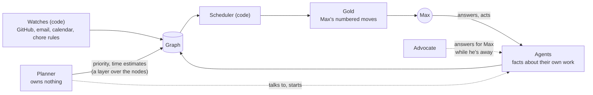

# Max's attention: what reaches him, and in what order

How the harness decides what reaches Max: the map of everything, the gold list of his own moves, the planner that keeps both true to his goals, and the questions and actions agents bring him. It opens with one day as he lives it, then the parts, then every need, grouped by the part that meets it, then what is still open.

## A day

Max wakes in Wellington. His day is his waking day, in New Zealand time; when he travels he tells any agent "I'm in London this week" and the day moves with him.

He opens the harness on his phone, and the map is there: every agent, every PR, question and chore at once. Most of it is muted (sub-agents working, things waiting on a supplier, a PR waiting on CI), and his eye slides past it to the gold.

Five or six gold items, numbered: moves only he can make. Under each, in small text, a few words of what it is; its place on the map, beside the agents it touches, says the rest. The order is not an agent's opinion. Code computes it from facts on the graph and recomputes it the moment anything changes, so it is never stale. A two-minute approval that frees three agents sits near the top; a "quick yes/no" that has actually cost him six minutes each time counts as six minutes. Some items can't open until a date, some are due on one, some get worse the longer they wait, and older items push up. A person waiting on him comes before an agent waiting on him. His most important long work always holds a share, and one item a day is something he enjoys.

He taps #1, a question from the agent fixing dictation. It opens a page that agent built from the harness's kit, in its own colour and pattern: what it is trying to do and where that fits in the plan, the choice it is stuck on and what each option would lead to, a diagram, and at the bottom a box with the microphone already listening. He talks; his words go straight back to the agent, which wakes and carries on, and the item leaves gold.

#2 is an action: merge a PR, already rebased, green and described. What to do there is obvious, so the tap goes straight to GitHub. #3 is a reply to a supplier that an agent drafted. That is not obvious, so it opens a short page first (who they are, what they asked, the draft) and then a send button. Nothing goes out to another person without his yes.

Halfway through, he says to an agent "let's also start a garden project". It checks the forecast: his hours this month are spoken for, and here is what would slip. It tells him so, plainly, and he can still insist.

He stops for the day. Agents that need him now ask the advocate instead, and only what is truly his waits. Nothing buzzes his phone unless it is gold.

Behind it, the sources feed the graph: watches (code reading GitHub, email, his calendar and his chore rules) and the agents, each publishing facts about its own work. The planner runs weekly, and whenever he decides something. It owns nothing; it reads what happened, works back from his goals, and adds what the agents can't: how long things will really take, and their priority. When it finds a gap (a commitment made by email that nothing is working on, an agent with thin facts, an agent waiting on a question whose premise has changed, work that looks dead) it talks to that agent or starts a new one. Every agent can see the usage, so the work fits the week's limit.

## The parts

- **Sources.** Two kinds feed the graph. Watches are code: they read a source (GitHub, email, the calendar, chore rules) and its state is the truth; no agent can write it. Agents are the other source: each publishes facts about its own work, and writes only its own nodes.
- **The graph** holds everything open: agents and sub-agents, PRs, questions, actions, chores, promises. A dependency is a watch: "A waits on B" and "wake A when B settles" are one relationship, so the refusal of a cycle covers both.
- **The planner** is deep and runs weekly, and whenever Max decides something. It reads what happened through the view the advocate uses, works back from his goals, finds the unknown unknowns, and makes sure the graph holds everything and that its facts are good enough to schedule from. It writes a layer over the nodes (priority, time estimates) but owns no work: anything that has to change in what an agent does, it asks that agent, or starts a new one. It may run as several tasks: one gathers the context, then a fork per job.
- **The scheduler** is code, if the planner's layer is enough (Max: "That would be even better, ideally"): a deterministic function from the graph to gold, rerun whenever a fact changes.
- **Gold** is Max's own moves, numbered.
- **The advocate** stands in for Max while he is away, and checks pages, questions and reports before they reach him.
- **Not yet:** a coach (coaching probably happens in place; Underview's coach "hasn't been doing its job that well"), and the action lock, which may make him do gold in order. Until the lock exists, nothing assumes he will.
- **Not needed:** a coordinator (the harness runs, restarts and owns its agents) and a decision log (his answers are already recorded facts).

## The needs

Each need is one line, grouped by the part that meets it. *Built in* means the harness does it by construction, so no agent needs telling; *Work* means it matters at work and not at home; *New* means Underview never had it.

### Gold and the scheduler

- **G1** His first moves, numbered, in gold, ready when he arrives.
- **G2** Gold holds only his moves. Nudging someone is its own item.
- **G3** *Built in.* A done item drops out by code.
- **G4** Ranked by what the goal is worth, whether it is really his, and leverage: what his minute releases. Unknown importance is not high importance.
- **G5** Tiny unblocking moves come early, and "tiny" is his measured time, not the label: a yes/no costs about six minutes of loading context.
- **G6** A person waiting on him outranks an agent waiting on him. *Work:* a teammate goes first, whatever the size.
- **G7** His most important long work gets a protected share.
- **G8** It shows what is not today, and why.
- **G9** Age has a positive weight: older items rank higher.
- **G10** No daily target, the list is overfilled, and working out of order is not going off plan.
- **G11** One enjoyable or tidying item a day. A day is his waking day in New Zealand time, a global setting he can change by saying so.
- **G12** A gold item shows its title and a very small description; its why lives on its page.
- **G13** Dates only on items that have them: when it opens, when it is due, and how fast it gets worse if left. Marked as they come close and once they pass. They inform the ranking but don't decide it.
- **G14** Only gold can interrupt him. *New.*

### The planner

- **P1** Commitments become steps, in a schedule he mostly follows.
- **P2** It finds what nothing lists: at home, emails and commitments in his own system, and things he has forgotten; *Work:* his PRs, review requests and issues. A commitment with no work under it is the loudest gap.
- **P3** It checks agents' facts against the real thing. Where they are stale or thin, it asks the agent to fix the instructions behind them and act on them.
- **P4** It sets priority and time estimates. Estimates come from his measured time, with hands-on time and elapsed time kept apart.
- **P5** Steps are framed as opportunities, with a date only where someone else holds one.
- **P6** It reads context through the advocate's view: his messages, the call summaries, and agents' results and compaction notes in full.
- **P7** Work that looks dead: it asks the owning agent to consider deleting it. The agent deletes it if the answer is obviously yes, and otherwise asks him.
- **P8** The forecast. When he starts something new, the agent he is talking to checks it and tells him no if there is no time: "Don't do that. Do this instead." Never a target. *Work:* also something to manage up with.
- **P9** An idea is a planned node owned by its area's agent, not a list the planner keeps.
- **P10** It nudges an agent left waiting on a question whose premise has changed.

### The map

- **M1** It shows everything, agents and sub-agents included. What isn't his recedes, styled so his eye slides past it, and gold stands out.
- **M2** Shape shows the kind, fill shows whose move. No legend needed.
- **M3** One cue per party (an agent's colour and pattern), the same everywhere.
- **M4** Arrows, not words. Separate islands, with lines crossing between them; hovering highlights the neighbours.
- **M5** An arrow points from the dependent to what it depends on, with a solid head, at the exact item and the event that matters (a migration waits on the release, not the merge). An arrow to nothing is refused.
- **M6** *Built in.* Old work can't come to depend on new work: refused on write.
- **M7** Planned work is dashed, and doesn't look like what it will become.
- **M8** Things waiting on the outside world stay quiet (grey, with the source's logo) until they are his move.
- **M9** Something that can't start until a date is grey, says when it opens, and is nobody's move. A start date is not a due date.
- **M10** *Built in.* "Working" shows only when it is true; an idle agent whose next step is its own shows as stalled. The animation is cheap enough not to make dictation drop.
- **M11** Only open items show. A finished project folds into an archive card.
- **M12** State shows as icons, never words.
- **M13** A node's face says what it is, why he cares and what a tap does; its title says what the work changes.
- **M14** *Work.* Work on a branch shows as a branch, then becomes the PR; about three or four open PRs per region.

### Sources

- **S1** *Built in.* A source says its own state, through watches, and agents can't write it. Whose move it is passes on by itself once someone acts.
- **S2** *Built in.* Each fact has one writer.
- **S3** A source's adapter carries the domain's conventions (*Work:* an approval stands through new commits). The harness says which sources it reads; where there is none, his word is the source.
- **S4** A promise he makes in a chat ("I'll review that") becomes a node waiting on him; where it can, it becomes source state instead.
- **S5** *New.* His calendar is a source, read-only, so agents know his day.
- **S6** Recurring chores are rules, and each occurrence becomes a dated node.

### Agents' facts

- **F1** An agent writes only its own nodes. The planner's layer is the only other writer.
- **F2** A region is a goal, not a session or a repo; probably an area's subtree.
- **F3** The why says which goal, where it stands and what changes when it is done. No status field.
- **F4** *Built in.* Bad facts are refused on write, saying how to fix them.
- **F5** No "urgent", only overdue. Broken for someone right now is due now.
- **F6** An agent ends its turn only on something that needs someone else.
- **F7** It checks every state it can read before asking or claiming.
- **F8** It restates the goal and the terms, gives the why before the action as a chain of consequences, and says where the item fits in the plan.

### Questions, actions and pages

- **Q1** A question is a node its agent depends on, asked through a tool, in blocks: one block each time it waits on him. It comes with a page, always, with the answer box on it and the microphone listening; the answer goes straight back.
- **Q2** The harness gives agents a kit for pages: their own colour and pattern, a slot for the answer box, and diagram parts, so a good page is quick to make.
- **Q3** A tap goes straight to the place he acts only if what to do there will be obvious. Otherwise it opens a short page with the context, the action and then the link, or he does it in place.
- **Q4** Agents ask only what is really his, and make and log the obvious calls. What needs neither his judgement nor his access never reaches him: the advocate answers it.
- **Q5** A question carries its why and, often, what each option implies.
- **Q6** He always answers free-form, actions included.
- **Q7** An action arrives ready to do (a rebased, green, described PR; a written script). Chores arrive drafted.
- **Q8** An item is off his plate once his part is done, and comes back only when it is his again.
- **Q9** Nobody else gets an obligation without his yes. The graph shows the draft; sending it is his.
- **Q10** Answers stay with their questions.
- **Q11** *New.* An agent can edit or withdraw a question, or add to its block, when its premise changes. The harness checks some kinds of action done by itself.
- **Q12** Pages show rather than tell, put each fact in one place, show the eventual state, the current state and the path, drill down to the real thing, and link instead of repeating.
- **Q13** *Built in.* He reaches pages through the graph in rank order, and no agent opens one at him. A page sits on its agent's node.

### His words and the advocate

- **W1** *Built in.* The corpus is what he saw, paired with what he replied.
- **W2** Recent words weigh more (about six months).
- **W3** Praise and hedges are kept too.
- **W4** *Built in.* A search stays in its domain.
- **W5** *Built in.* Replay up to a chosen moment, to test the advocate.
- **W6** One big read with a map, instead of many small lookups.
- **W7** The advocate checks reports, pages and questions before they reach him. It judges process, not code, can't act, and is tested against the times he actually redirected work.
- **W8** While he is away, agents ask the advocate, and he comes back to progress.

### Usage and upkeep

- **U1** *Built in.* Agents stopped by a usage limit, a crash or the end of his day resume by themselves.
- **U2** Every agent can see the usage, and usage shows per region against what the region is worth.
- **U3** Daily capacity is about a fifth of the week's limit. The agent above the areas can pause work when usage runs low.
- **U4** Instructions are purposes, not rules, and change in the planner's weekly pass, through the agents that own them.
- **U5** Parking keeps the need, not the work: one act abandons the work, frees its resources and leaves an issue.

### The phone and the browser

- **H1** *New.* Everything in gold can be done one-handed on the phone, by dictation.
- **H2** *New.* A browser action arrives as the agent's own tab, at the step only he can do (a login, a choice), not as a list of steps.

## Open

- **Is the scheduler pure code?** It can be if the planner's layer carries enough (priority, time, how fast each item gets worse). Max: "now I'm wondering whether we even need the scheduler [...] That would be even better, ideally."
- **Does a question carry a recommendation?** Max: "It doesn't need a recommendation. It needs a why." Against it: without one he can't agree in one word on the phone. Optional, probably.
- **Short forms of tool results** for later reading (the planner's view, searching an old chat, compaction). The pick so far: none; show each call's summary and the full result on demand, since most results are never read again.
- **The planner's shape:** one agent, or a task that gathers the context and forks per job.
- **A region** is probably an area's subtree.
- **The coach and the action lock** wait until there is something to build them on.

## Where this came from

Underview is Max's work dashboard and its agents. His work agent wrote its needs as 125 user stories, each with the episode that showed it, plus seven tensions with its picks: [`underview-stories.html` at 2a1320c](https://github.com/maxeonyx/agent-harness/blob/2a1320c/docs/underview-stories.html) ([rendered](https://raw.githack.com/maxeonyx/agent-harness/2a1320c/docs/underview-stories.html)). Max reviewed them on 31 Oct: many good, some work-specific, some confused (the scheduler finding unknown unknowns is the planner's job), some made unnecessary by a harness that hosts its pages and runs its own agents. This document is that review: the needs adapted to the harness, merged, corrected and extended. Go to the stories for the episode behind a need.
