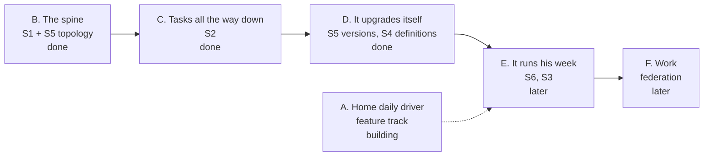

# The plan

How the harness gets from `main` to [the vision](vision.md): two tracks, six milestones, what is next, how the work runs, and what only Max can decide. The open work itself is in [todo.md](todo.md).

## Two tracks

The vision's constraints interact, so they are built up in two tracks that run at once:

- **The discipline track** builds the six [structures](vision.md#architecture) one at a time, in dependency order. Each is designed, built as a vertical slice with a demo, then integrated into `main` by migrating everything onto it and deleting what it replaces ("when we integrate into core we leave NOTHING half done").
- **The feature track** builds on `main` as it stands, fast and fail-fast, with feedback from Max and from running the harness on its own development. A feature uses the concepts that exist and never adds a second mechanism for a concept a structure owns: no new protocol between face and brain, no refusal out of band, no file read in the brain. Moving it onto the next rung is then mechanical.

## Milestones

Six milestones, named by what Max can do when each lands. B to F are rungs of the discipline track, one structure or more each; A is the feature track.

| Milestone | What Max can do | Status |
|---|---|---|
| **A. Home daily driver** | Home agent work in the harness instead of Claude Code plus dictation pasted from elsewhere. | Building: everything in the [user stories](vision.md#user-stories) under "Talking to agents" and "Seeing and steering the work" works in some form except notifications on a closed app; the browser agent is headless until the SSH limb reaches his own browser. |
| **B. The spine** | Drafts follow him between the PC and the phone, every text box is durable, refusals show where they happened, and a restart carries on. | Done. |
| **C. Tasks all the way down** | Pause, stop and abandon do what they say, down the tree; agents fork their own work; background work is handed to its owner. | Done. Gaps: threads and some processes have no owner yet ([todo](todo.md#tasks-s2)). |
| **D. It upgrades itself** | An agent improves the harness and relaunches it while he watches; a broken build bricks nothing. | Done. Gaps: one binary, and old sessions on old builds ([todo](todo.md#replicas-and-versions-s5)). |
| **E. It runs his week** | A scheduler orders his queue with reasons and learns; domains; this project's own work runs on the harness while he is away. | Later. |
| **F. Work** | A work domain on its own machines, its data never leaving them; MCP and his skills. | Later. |

Far beyond these: a query engine on the scale of his relational CRDT design, programs as data, and the pass over the machine code.

## What is next

In Max's order:

1. Code cleanup. Done.
2. Notes into the repo's docs: this file, [vision.md](vision.md), [todo.md](todo.md) and [glossary.md](glossary.md).
3. A dashboard rebuild that renders these docs directly (and perhaps lets Max edit them), alongside what it generates from the code.
4. Discuss a new process with Max (below).
5. Continue milestone A's gaps, then E.

What is in flight at any moment (open PRs, running agents and brains) is not written here: the dashboard derives it.

## How the work runs

The process as it stands is in [`AGENTS.md`](../AGENTS.md#how-the-work-runs) and the role files in [`.claude/agents/`](../.claude/agents): an orchestrator holds the direction and launches scopes of tasks; designers decide models; engineers build in their own clones; a `max-advocate` answers for Max when he is away; no agent verifies its own work, so an independent reviewer verifies and merges.

Max wants to redesign it, and to discuss the new process with him before it changes. His critique:

> The max advocates were never quite working, the designers were too expensive, and the engineers were doing an ok job but needed more checking or refinement passes, but also to be cheaper. And the worst role was you the orchestrator, who was both recieving my random thoughts and feedback and supposed to be moving everything forward according to a rigid process. I would like to actually discuss the new process.

He also settled one principle for any process: "don't allow conflict of interest". An agent never verifies or abuse-tests its own work; that is another agent's task, "an important foundation of the ongoing process".

## Questions only Max can answer

Most of the design questions raised so far are answered, and the answers are in the vision's "Settled" lines. These are open:

- **System messages.** Whether to revisit the rule that only Max's own words appear as user messages, for what the harness tells an agent.
- **Spawn: blocking or not.** Whether a spawn always blocks its parent until every result is in, or a parent can carry on while background scopes run.
- **Pause.** Pause is out of the MVP and gets its own button; what exactly it freezes is undecided.
- **Daemons.** How long-running background processes an agent starts (a dev server) should be owned. The first framing of the question didn't land with Max, so it needs reframing.
- **What the harness loads from `CLAUDE.md` and skills,** and how skills are split by role ("later").

The core crate's "Provisional" list ([`crates/core/src/lib.rs`](../crates/core/src/lib.rs)) marks where these live in the code. Some of its entries Max has since answered; [todo.md](todo.md#docs-and-dev) has the item to update it.
