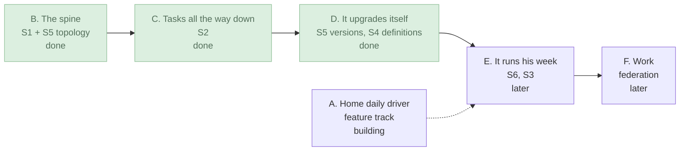

# The plan

How the harness gets from `main` to [the vision](vision.md): two tracks, six milestones, what is next, how the work runs, and what only Max can decide. The open work itself is in [todo.md](todo.md).

## Two tracks

The vision's constraints interact, so they are built up in two tracks that run at once:

- **The discipline track** builds the six [structures](vision.md#architecture) one at a time, in dependency order. Each is designed, built as a vertical slice with a demo, then integrated into `main` by migrating everything onto it and deleting what it replaces ("when we integrate into core we leave NOTHING half done").
- **The feature track** builds on `main` as it stands, fast and fail-fast, with feedback from Max and from running the harness on its own development. A feature uses the concepts that exist and never adds a second mechanism for a concept a structure owns: no new protocol between face and brain, no refusal out of band, no file read in the brain. Moving it onto the next rung is then mechanical.

## Milestones

Six milestones, named by what Max can do when each lands. B to F are rungs of the discipline track, one structure or more each; A is the feature track.

| Milestone | What Max can do | Status |
|---|---|---|
| **A. Home daily driver** | Home agent work in the harness instead of Claude Code plus dictation pasted from elsewhere. | Building: everything in the [user stories](vision.md#user-stories) under "Talking to agents" and "Seeing and steering the work" works in some form except notifications on a closed app; the browser agent is headless until the SSH limb reaches his own browser. |
| **B. The spine** | Drafts follow him between the PC and the phone, every text box is durable, refusals show where they happened, and a restart carries on. | Done. |
| **C. Tasks all the way down** | Pause, stop and abandon do what they say, down the tree; agents fork their own work; background work is handed to its owner. | Done. Gaps: threads and some processes have no owner yet ([todo](todo.md#tasks-s2)). |
| **D. It upgrades itself** | An agent improves the harness and relaunches it while he watches; a broken build bricks nothing. | Done. Gaps: one binary, and old sessions on old builds ([todo](todo.md#replicas-and-versions-s5)). |
| **E. It runs his week** | A scheduler orders his queue with reasons and learns; domains; this project's own work runs on the harness while he is away. | Later. |
| **F. Work** | A work domain on its own machines, its data never leaving them; MCP and his skills. | Later. |

Far beyond these: a query engine on the scale of his relational CRDT design, programs as data, and the pass over the machine code.

## What is next

In Max's order (18 Oct): finish the cleanup, then discuss a new process with him (below). After that, the recommendation is milestone A's gaps, then E.

On 28 Oct he asked for a design, before it is built, of how agents relate and how he works with them: main agents per area, ownership, agents that serve many, the planner, agents answering with pages, and Underview's way of working (the [vision's user stories](vision.md#user-stories) dated 28 Oct). Those stories are hypotheses about his best workflow, not requirements, until each is taken back to its root why and agreed. The design starts from first principles: "what do I need to know? What is ultimately possible? You know, what are the fundamental logical constraints in scheduling, in you know, cancellation? You know, what is the existing state of the art?" He reads it as a visual page of its own, not a markdown file, a PR or a chat message. "I'm interested in the design here, please. I don't just want to barrel through and build it. I want to get it right." Today: "I've got a chat. It's working. [...] We've got kind of limbs, but it's bodged. It doesn't feel quite right yet. We don't really have any of these relationship models working how I like or expect." He holds it open ("There's some structure that needs to be thought through that I haven't yet"). The main agents and pages he thinks are "mostly a change to the UI [...] not really a change to the model"; the ownership model is a change to the model. His writeup of Underview's requirements, from his work machine, is an input he'll write "if I can". Harness work as a whole is "not necessarily 100% [...] the most priority thing" for him.

The first-principles page for the ownership model (local, not in the repo: `~/agent-harness-workspace/pages/ownership/`) recommended one ownership tree, plus messages and watches, which own nothing, with held resources collected after their last holder. Max agreed with its shape on 28 Oct, and his answers are the vision's 28 Oct stories. Three fixes every candidate agreed on he said yes to: a limb lets go once no live task holds it, an expired login holds tasks instead of failing them, and a server handed to him lives until he stops it.

What is in flight at any moment (open PRs, running brains and the clones with work on them) is not written here: the dashboard (`dev/dashboard`) derives it.

## How the work runs

The process as it stands is in [`AGENTS.md`](../AGENTS.md#how-the-work-runs). Max wants to redesign it, and to discuss the new process with him before it changes. His critique:

> The max advocates were never quite working, the designers were too expensive, and the engineers were doing an ok job but needed more checking or refinement passes, but also to be cheaper. And the worst role was you the orchestrator, who was both recieving my random thoughts and feedback and supposed to be moving everything forward according to a rigid process. I would like to actually discuss the new process.

What the new process has to say, in his words: "the process we are following (principles, constraints, agents, feedback loops, etc), the current plan, the current inflight work. How my feedback, my advocate's feedback, and designer output get taken into account, how engineers build toward the eventual state, how we keep our process sustainable, and more."

Any process keeps what [`AGENTS.md`](../AGENTS.md#what-is-settled) lists as settled, and how he wants his asks taken: "You should take my technical asks as guesses not decisions. You should take my feature asks as evidence of my wants, not requirements [...] If you're just agreeing with me, no point at all."

## Questions only Max can answer

Most of the design questions raised so far are answered, and the answers are in the vision's "Settled" lines. These are open; where one has a recommendation, he can accept or reject it:

- **The new process.** Next in his order, once the cleanup is done: [how the work runs](#how-the-work-runs) is his to redesign, in a discussion with him first.
- **Unpausing.** Pause stops new model requests, holds a response's tool calls until play, and holds a finished tool's result (Max, 18 Oct). It gets a button of its own, and the MVP doesn't need it. Open: how he resumes ("How do I unpause? Okay, I didn't think about that. Lol."), whether pause and play share one control, and whether his words sent to a paused task resume it, as they do today, or wait until he resumes it. Recommendation: one pause/play toggle on the node, with Stop as a separate control.
- **What the harness says to an agent.** Today only Max's own words are user messages in his name; everything the harness tells an agent (the time, a notice, a compaction) is user-role text marked `[harness]`. The alternative is a separate system channel in the conversation. Recommendation: keep `[harness]` text until a framing problem is measured, as the fork-framing spike did for mandates.
- **Meta roles for orchestrators.** Max decided (29 Oct) that a role is the abstract thing, an agent the concrete one, and a limb infrastructure, one per machine and user ([vision](vision.md#s4-roles-agents-and-limbs)). Open: whether orchestrators become meta roles, holding only the brain's tool sets: "I'm not sure if I really want orchestrators to be that way, but I think I do" (28 Oct).
- **No chat interface.** Whether an agent's page, with a dictation box, replaces the chat as his main interface to an agent ([vision](vision.md#seeing-and-steering-the-work)). He wants it drilled back to its why and examined broadly before he is confident of it.
- **Who tracks held resources.** The harness, or agents ad hoc with instructions, which he finds lighter; and what happens to a clone, which holds state, after its last holder ends ([vision](vision.md#what-agents-can-do)).
- **Which of his instructions and skills each agent gets.** Today every role holds the `user` tool set: his whole `CLAUDE.md` and an index of the skills named in `roles/skills.txt`, one list for every role, each loaded on demand. He has said "later" to choosing which lines the harness loads and to splitting skills by role. Recommendation: decide it with the process redesign, since roles change there.

The core crate's "Provisional" list ([`crates/core/src/lib.rs`](../crates/core/src/lib.rs)) marks where decisions live in the code; [todo.md](todo.md#docs-and-dev) has the item to cut it down to code-local caveats that link here.
