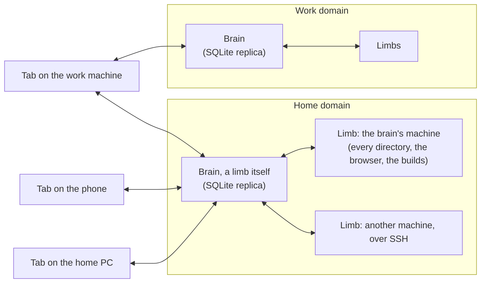
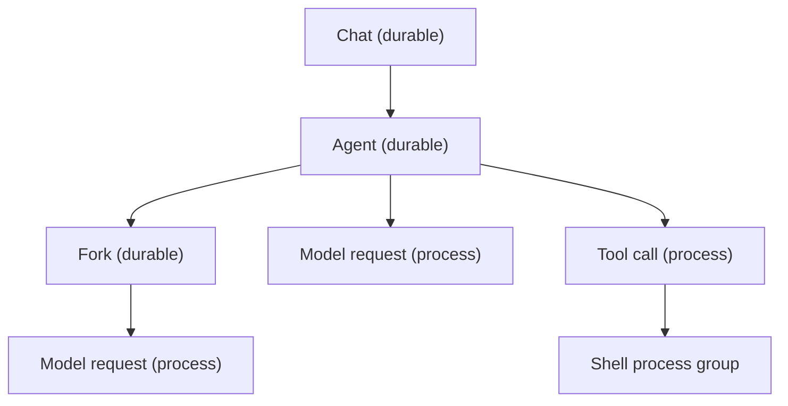

# Vision

What the harness is when it is finished: the goals, what Max does with it, the six structures it is built from, the episodes that show a design is right, and the prior art. The source is Max's [vision gist](https://gist.github.com/maxeonyx/014463e0964bebd0add4b914971c492f); this restates it with his later words, which win where they differ. What is built today is in the crate docs (start with [`crates/core`](../crates/core/src/lib.rs)), the way there is in [plan.md](plan.md), and the words are in [glossary.md](glossary.md).

## Two goals

Max named two halves, "equally important": "First is the harness needs to work like I want it to. But second is I want it to be built how I want it to."

- **Works like he wants.** A harness he lives in every day: talking to agents, watching the work they do for him, and managing what needs him. The user stories below are this half.
- **Built how he wants.** "It's not just a harness that I want to use. It's a foundation for things I want to build." A small number of principled models, each concept built once, that he understands and can build other software on. The architecture below is this half.

Neither has to be finished first, though "obviously I want [...] as much of it done as soon as possible".

What is unique to it, in his weighting (2026-07-31): the user turn; the "hardcore 'forking' subagent model", with cache efficiency and structured concurrency; the limb model ([S4](#s4-roles-agents-and-limbs)); and agents owning their own compaction. What he calls non-unique, non-exhaustively, "good taste" choices from other harnesses: a decoupled monolith, composable configuration, self-modification, and the context model ([S3](#s3-contexts-what-an-agent-was-told-as-values)).

## User stories

What Max does with the harness when it is finished, grouped by the part of his day it serves. His feature asks are evidence of what he wants, not specifications: each story states the want, and quotes him where his words carry a hedge. None is a requirement until it has been taken back to its root why, as a user story, and agreed: "it's not a requirement until it's been deconstructed and understood properly. And agreed upon, I guess" (28 Oct). The stories dated 28 Oct have not been taken back yet. They are his guesses at his best workflow: hypotheses to test.

### Talking to agents

- **One text box, dictated into, everywhere.** Max dictates most of what he says. Every place he answers is a free-text box, and dictation is built in, so it works where his operating system gives him none.
- **A staging box with one Send.** "I very, very frequently change my mind." A press of Send with words in the box stages them: they move up to the top of the box, above a divider, and the box empties for more. An attachment stages the same way, and so will the user turn's other contributions. A press with the box empty sends everything staged, which reaches the agent at its next request, saying what Max had seen when he wrote it. There is no queue: "I don't think we need queue at all. I don't use it."
- **Nothing he types is lost.** Every text box is durable: a reload, a crash or the scheduler moving him elsewhere keeps his words, and the draft follows him from the PC to the phone. Typing in one draft on two devices never silently loses text (a text CRDT is the eventual answer; today a conflict opens a second draft).
- **A question is a page plus a node, answered by talking** (31 Oct). Asking is "a hard thing", to be done "with care": the agent gives "a full overview of the context, all of the information in a rich format, in an HTML", presented cleanly, ideally visually, so he has everything he would need to answer. He answers by talking, in a dictation box on the page or in the chat, and he can reject its framing. On the graph the agent depends on the question's node; clicking it opens the page, and sending his answer takes him to the agent, where the call's result or the background work finishing shows. Whether the agent ends its turn with the page or calls a question tool and waits on it is the same thing to him. He leans to explicit tools for questions and actions, because a tool lets an agent ask in the background, "which otherwise is not possible" (a background fork that asks would do it too: "kind of reasonable, but it's kind of the same"): "I feel like it's maybe more clear to just explicitly have the question and the actions as tools [...] I'm leaning towards that recently". An agent asks in blocks rather than one node per question, one block per "individual instance of waiting on the user [...] what set of stuff could the user come back and answer as a block that would unblock the agent". It can maintain a question it has asked, perhaps by "cancel and reissue a question tool after editing the page and reattaching it or something." Whether answering a foreground question splits the chat is open: "Maybe if it's a foreground question, yes."
- **Done is up to him.** A user-facing chat is waiting on Max whenever its turn has ended, and it is finished only when he says so.
- **The user turn.** Max contributes to a chat the way an agent does: he opens a file, runs a command or searches, and what he did is attached to the conversation, so the agent sees his work without being told. Opening a file to read is different from opening it to edit; an edit enters the chat. ("This is a cool rethinking of what it means to collaborate with an agent.")
- **Retry, edit and go back.** He can retry a reply, edit what he said, go back to an earlier point, and choose between versions of a reply. Nothing he moves away from is lost.

### Seeing and steering the work

- **The whole page is a graph of everything he is doing.** At the top level the page is a map of nodes: every agent and chat, with background work hanging off them, and disconnected components for separate projects. Each node shows the state of its task, from metadata its agent publishes. Clicking a node opens it in place as the chat; panning away closes it. Finished projects fold to their root as a small archive card.
- **His own to-dos are in the same graph** (28 Oct: "Correct, they do. That's exactly right"). So are items "that will maybe come back to me, but are waiting on something else": he contacts his electricity provider and waits on their reply, and "there's a card sitting there with their logo, kind of grayed out or white or something, non-prominent. Not prominent because I don't really need to see it until it's my action." A to-do typically links him out to where he acts: the place itself, the chat where he answers, or the page that introduces the question from first principles, which he thinks "should contain a dictation box for me to answer it in band without having to go back to switch tag to the chat".
- **User actions** (31 Oct). An agent can ask him to do something: "go to this website and do this thing", create a ticket, review one, or "here's a draft email, send it or not". Clicking the action's node opens the same kind of page as a question: the context ("What is this? Why do I care?"), the details, and exactly what to do, usually with a link out, or he acts in place through a user turn. It need not link out: a page the harness hosts could do it, such as an email UI later that drives the agent's email MCP tool, since "why does the MCP tool only have to be used by an agent? It doesn't. I can use the MCP tool as well." An action "is also implicitly a question": its page has a feedback box, and "there's yes and there's no and there's the question is wrong", so feedback can say it was the wrong action. He marks it done, "or ideally the harness is able to check for a given kind of action when that thing is done". At work the usual action is a GitHub pull request: once he marks it ready and requests a colleague's review, "it's no longer my problem". The agent waits on his review, then the colleague's, is told of comments ("we can think about that"), and once the pull request is approved "should be handed it back to merge".
- **Underview's way of working, hosted** (28 Oct). Underview, his dashboard shared across agents, "worked quite well for managing my home life", and he wants that workflow in the harness: regions, links between the things on it (not only agents), and tasks an agent presents to him, each of which he clicks to go to that place. "But we can do better than Underview because we're building an actual harness." He doesn't want it copied, "because it's not quite how I imagine it yet. And also because how I imagine it can be wrong." He'll write up the requirements behind Underview from his work machine "if I can".
- **An agent answers with a page** (28 Oct). He wants to talk to an agent "primarily through a dictation box like this, a rich view, not a text or chat view". The agent comes back to him "with its new HTML page, not with an update [...] response message", together with updated metadata about the state of its task, which is rendered into "a big graph of all the things I'm doing, the status of them all". Underview can't host the agents' pages; the harness can, and gives agents guidance on building them, perhaps through a sub-agent whose limb is for building pages for its parent task. That sub-agent would need to search context, to get everything the page needs. The harness provides the tools and styles; every area "can have some kind of like color or pattern, and each agent within that can again have variant color and patterns, so that it's easily visually distinguishable for me". He is "very seriously toying with the idea of no chat interface at all": the overview page has his to-dos, and each agent that depends on him keeps a page updated. He is unsure of it: "I'm not sure if I really like it, but I like it [...] It needs to be drilled back and made into a stronger idea. I need to be confident it's what I want. I need to examine it broadly."
- **Plans show as provisional nodes** (31 Oct: "This is future, we don't have to do this now"). "The agent is encouraged to write out its plan into the harness metadata, and that would show as provisional stuff, for example, planned pull requests, planned design agents, planned user questions": dotted nodes on the graph for work that doesn't exist yet.
- **The chat is a log of what happened.** Markdown, code, images, SVG and HTML render in place, and files an agent mentions open in context. A spawn links to its child's node and back. The exact context sent to the model is one toggle away.
- **Several tabs and devices at once.** He can open tabs side by side on different things, and use the same session from his phone and his PC.
- **Usage and context are visible.** How much of his usage window is left and when it resets, and how full each context is. A chat stopped by a usage limit carries on by itself once the limit resets.
- **Stop that stops.** Three acts over any subtree: **pause** freezes the loop at once and spends nothing; **stop** asks each agent to wind down gracefully; **abandon** tells it the work is no longer needed, lets it tidy up, and ends it. Each reaches every agent and process below.
- **Choosing the model and effort** for a chat, and changing them while it works.
- **Search across past chats.**
- **Notifications** when a chat needs him while the tab is in the background (on a closed app too, later: "a good feature for later").

### Agents that work well and cheaply

- **A fork-heavy workflow.** An agent forks for each phase of its work: the fork does the phase and returns a summary, so the main context keeps only the summaries and "naturally elide[s] all tool call info". A fork's result can attach the tool calls its parent needs to see. Fresh agents are for bigger tasks or other roles.
- **Agents compact themselves.** An agent compacts when it really switches tasks or its context is mostly summaries, warned as it nears the limit, and carries on as the same agent.
- **Structured concurrency: a parent owns its children.** Nothing runs that nobody owns. A task never ends with background work running unless it explicitly hands that work to its owner, or to Max, which makes it his obligation. In this hierarchy an agent and a task are "kind of similar, the same thing". His 28 Oct guesses at the shape:
  - **Spawn in the foreground or the background.** "Fork per phase is spawn and join. Background spawn is spawn and separately join, and join is watch. Watching something you own." The fork workflow wants the foreground: "an agent should fork for its first task, then fork again for its second task, etc. [...] that definitely implies it should be synchronous". In the background, the parent keeps working beside its children ("parent-agent blocking on sub-agents doesn't really work in my model").
  - **The join is a tool call.** "The agent need not end its turn. In fact, it is told not to end its turn until it's done. It should explicitly wait on its background tasks."
  - **Three phases.** "to start with, there's only the parent. Then there's a middle section where there's the parent and children. And then there's a final section where there's the children have finished and the parent is only the parent cleaning up." He thinks it is "potentially common" for the parent to need to do more after its last child has finished.
  - **Not done until cleaned up.** "An owner can't end until its workers have ended", and "the task is not done until the task is cleaned up." Cancelling a parent abandons its children too, cleaning up all their resources.
  - **Only an agent that has Max can hand to Max** (28 Oct, a hypothesis). He likes being handed things, but only by an agent that has him available. An autonomous sub-agent hands work to its parent, and the parent hands it to him. `pass` already works this way: it goes to whoever started the agent, so to Max only if he started it.
  - **A failure is not a decision.** When an owner fails, its subtree is held, not ended: "They're held. Definitely they're held. Do they even need to be paused? I don't know." He finds the question not quite well defined, and thinks a failing parent is "basically a pause": its work continues "until it, I don't know, needs a response from the owner", and the children's results are queued for it, or "they would fail too, probably. Like, it's somewhat unlikely for the owner to fail and the subagents to still continue".
- **Waiting on the outside world is code.** Anything that depends on something external (emails, GitHub) is ideally handled by code the harness runs rather than by an agent, or else by "a really cheap agent in a really minimal limb".
- **The cache is never wasted.** Forks share their parent's cache, and the cache still hits after the harness restarts.
- **Agents know what they were told, and when.** A change to something in an agent's context (an `AGENTS.md`, a skill, a tool) reaches it as a dated notice, never a silent rewrite.
- **Agents see what Max is doing**: what he was looking at when he wrote, whether he is present, what he edited.
- **The model-facing harness is shaped by the model.** "We want to make the model-facing harness like *it* wants, all else equal": tool-call ordering, parallel calls and framing follow what agents say works.
- **A curated skill set**, separate from Max's personal skills, which he reviews.

### What agents can do

- **Prevention by construction.** There are no permission prompts ([settled](../AGENTS.md#what-is-settled)): an agent can do what its role gives it and nothing else. "A full JavaScript sandbox counts. A JavaScript sandbox where you can write programs, but a classifier checks if they're read-only doesn't count."
- **Roles, not tool lists.** A role is its tool sets plus the context for using them. An agent with a directory gets a shell; a chat needs no directory; roles may expose parameters Max fills in when he starts one, with a rich picker for directories and remote environments.
- **A browser agent for life admin.** A dedicated agent drives a Chromium browser through scripts, with screenshots used sparingly, its own tabs as resources it can hand to Max, and Max's own browser on his desktop as the eventual target. The usual shape is "get Max to do most of the browser usage, then do the tedious part, then let him continue."
- **Limbs anywhere.** A limb runs on the brain's machine or on another one over SSH, one per machine and user account, and survives the brain restarting.
- **Web search and fetch**, and an MCP client.
- **Workspaces and clones** follow Max's existing pattern (shared directories, lazy clones); isolation is a separate action when it is wanted.
- **Agents that serve many and own nothing** (28 Oct). Ownership is not the only relationship between agents: "is there just one kind of relationship between agents? Not really." Some agents serve many in the background without owning their work. His example is an agent-instructions agent, which receives improvements from many agents, user-facing or autonomous, and has the process, the tools and a limb fit for improving the instructions. It "doesn't have to be one agent": it could be one limb with several agents in it, depending on whether the data model lets several work on it at once. Code does, through git, which agents understand as "a distributed partial order model [...] with manual merges"; other data not necessarily.
- **Two relationships that own nothing: messages and watches** (28 Oct). Ownership is one tree; beside it, agents can message each other ("Makes sense, I think"), and an agent can watch work it doesn't own: wake me when that settles. The harness refuses a watch that would close a circle of waits, which he calls "deadlock prevention by directed acyclic graph". Abandoned work doesn't keep running because something else depends on it, "but the dependent should be told": "The watch isn't ownership, so the watch just gets told it was abandoned."
- **Held, not owned** (28 Oct). Limbs, clones, browser tabs and dev servers are "potentially" held rather than owned, and cleaned up after their last holder. He leans to agents doing this "ad hoc for now, with instructions, because it's kind of lighter weight in my mind", but likes the harness managing it: "The harness knowing about it is kind of handy if the agent is, you know, paused or fails. It resumes a few weeks later. The harness can say, this thing doesn't exist anymore." Maybe one abstraction covers them, "like a persistent background process"; a browser tab is a further kind of resource, but "I guess we do want to build in browser integration and CDP into the harness. So, yeah, maybe representing browser tabs as that is exactly what we want to do." Clones are "the weird one": a limb, a tab or a dev server holds no state anyone expects to keep, but "you might keep stuff in a clone that you don't want it to be deleted."

### Managing his attention and his life

- **Inversion of control.** "I personally am not necessarily very good at prioritizing my time across all of the threads that need my input." An attention scheduler, an agent whose whole role is reading the domain's sessions, reordering his queue and editing its own priority document, puts first the thing that blocks the most and says why. He sets its rules "in a more reflective headspace", argues with its order, and it learns: "a goal of mine to be managed, not just to manage." In Underview he has a planner agent that sees all the open work streams, his goals, and the tasks' due dates and importance. It plans the order and relationships between things beyond what the streams themselves publish, takes his updates on what he has done, and reprioritises rapidly. When he comes to the page he sees "1, 2, 3 in gold, what are my first actions today".
- **Scheduling what is scarce** (28 Oct). Scheduling only matters where something is scarce, and two scarce things are the point of the project: his attention ("It's kind of the whole point of this project") and the usage window ("Try to do better than Claude Code on usage efficiency"). The third is a thing only one agent can use at a time, which he hadn't explicitly taken "into account, other than to generally like ownership as a concept": "we should designate a limb and an agent to it. A one-only limb, something like that." Git checkouts don't count ("so cheap [...] You can just make more. At least if you have small repos"), and he isn't sure his phone over ADB is one.
- **One tree to act on per domain.** He can look anywhere, but acts on one tree at a time in a domain, whichever tabs and devices he uses. It schedules his writing, not his reading.
- **Agents never create obligations for him.** Only his own action makes a session user-facing: "I'm supposed to approve the creation of user-facing sub-agents. And I think that that still holds" (28 Oct). An agent may ask, in the background, and carries on. Contacting a person on his behalf needs his say-so, unless he explicitly asked for it.
- **Work done while he is away needs nothing from him.** Left to work autonomously, agents should do work that improves his life, not work that leaves him "a bunch of approval actions when I came back". They also can't know what he did out of band: on 25 Oct, a day's prep for his evening was built from his notes, which were out of date, and most of it was for things he had already done.
- **A main agent for each area of his life** (25 and 28 Oct). He could "in theory" manage his home life (its admin tasks and responsibilities) in the harness's graph view, alongside agents' work. For any mode he is in he comes back to one main agent; hobby programming, life admin and support for Kibra's study are "reasonable divisions" with a main agent each. The main agent tells him how its sub-agents are doing: which finished on their own, and which are waiting on him, sending him to each for its part. There can be several main agents, and "even an agent over that would honestly make sense", to prioritise usage limits or coordinate shared pattern changes. Whether an agent over the main agents is the planner (above) is open. His examples are all home life, so an area sits inside a domain (below), which holds several.
  - **An area has an owning agent:** "a coordinator or an orchestrator. So it doesn't have necessarily direct tool calls. It deals with subagents mostly or only, and deals with harness metadata and, you know, HTML pages". It "would be the most common thing that I talk to."
  - **The agent above the areas may pause work** when usage runs low ("Actually, that's a cool idea. I like it a lot [...] Better than stopping in many cases"). It may also abandon its own subtrees, its own autonomous sub-agents, and things on his behalf.
- **Domains.** Each sphere of his obligations (home, work) has its own brain, queue and data. Data stays on its own machines; a face can show more than one domain, but home devices never see work data.

### A harness that keeps going and improves itself

- **Restart loses nothing.** Ctrl-C drains and exits; a second Ctrl-C kills. On restart every agent carries on, with no input from Max. A brain restart is not a cancellation, "if we do it right. It's just a pause and continue" (28 Oct).
- **A long outage holds the work.** After one, the root tasks are held instead, and his first task is probably deciding what continues. He thinks holding "makes sense", but that it is "not core" and "can be left for later".
- **Backups by default.** It "might be nice" for every brain he runs to hold all the data, synced in the background, so each backs up the others without confusing their records with its own. How that squares with a domain's data staying on its own machines is open.
- **It upgrades itself.** An agent edits the harness, builds it and relaunches it while its own session carries on: "While we want live editing, we don't want live bricking." A broken build bricks nothing.
- **Easy to run as a service**, reachable from his phone anywhere, and installable on Android.
- **Its own login, refreshed by itself** (28 Oct). The harness needs its own auth token, refreshed automatically: "every time I've gone to use the harness, it's been useless for me because the auth token is not working." He decided (28 Oct) that it gets its own login through its own OAuth flow, the way Claude Code does, so that the usage meter and dictation accept its token ("we'd be better off just pretending to be Claude Code"), and that it refreshes the login itself, "maybe with some kind of randomness on it": "We should just have two logins, I think." Its tokens live in the database, not a file, "so that it can sync across machines, ideally. If needed", perhaps encrypted later from a keychain or SSH agent: "It's internal state". Today only Claude Code refreshes the login ([todo](todo.md#replicas-and-versions-s5)).
- **Session data is his.** Token usage per session, and his sessions searchable and queryable, across every brain he runs.

### Building on it

- **A foundation, not just a harness.** The substrate under the harness (facts, replicas, views, sync) is one he can build other applications on, in the line of his earlier designs for a relational, local-first application foundation.
- **His life-management system on the same foundation** (25 Oct). He wants his personal records hosted "somewhere where it can be given some actual compute, some functions that automatically run when the agent needs it to, or, the agent can write scripts against it": "My ultimate vision is to have it hosted on similar self-built architecture as the harness itself, but that doesn't need to happen now."
- **Lowest cost, best performance.** A far stretch goal: the leanest agent harness there is, down to a pass over its machine code.

## Architecture

The full system is six structures. Everything Max named is an instance of one of them: durability classes, sent status, drafts on two devices, refusals in band, Ctrl-C twice, asides, domains. A constraint that fits none of them means a structure is missing or wrong, and that reopens design instead of adding a mechanism. This is the answer to his worry that constraints interact quadratically: mechanisms do, but a constraint that is an instance of a structure already built costs about the same however many came before it.

These are hypotheses, not rulings. Max: "I'm not ruling I'm suggesting, hypotheses for what is the best way to implement this [...] I want to see a beautiful software system built. But exactly what that is, is not up to me. It's up to what we discover."

Three sentences tie the structures together. Everything that happens is a fact at a time and a replica. Everything that runs is a task in one tree. Every boundary is a parse.

In code, `crates/core` holds every structure's types as one schema and `crates/brain` runs them; each structure below names its own crates.

Each arrow is a pair of one-way syncs of filtered replicas, and each filter is a query. Nothing else crosses a boundary. Every tab is a replica too, so a draft lives in the tab first. Work can see home; home devices never see work.

### S1. The substrate: facts at a time and a replica

- **Records.** A record is a fact at a replica (a brain, a limb, a browser tab, the phone), at a time in that replica's own order. What one replica has seen of another ("this replica, at t, includes that one up to u") is a record of its own.
- **Views.** Everything a person or an agent sees is a view derived from the records as of a time, incrementally where that pays.
- **Validity is a view.** A fact is accepted where it happens, and a derived view decides whether it is valid; only the valid subset crosses to the next replica. That crossing is the parse in "parse, don't validate". A refusal is a fact the source replica sees in its own copy.
- **Coordination is per object.** The few invariants that need one decider (a task's life, a scope closing, a name) are decided by the replica that owns the object. Everything else merges. Which invariants need a decider is the invariant-confluence test (Bailis): one does when two replicas could each keep it and still break it by merging.
- **Durability is declared per kind of fact:** never stored (streamed tokens), kept until processed, current state only (a draft, a focus), kept for a context or a session, or kept forever. Collection is the default, and replicas register, so the harness knows what is still needed.
- **Storage is an effect at one replica:** SQLite under a brain, the browser's own storage under a tab.
- **Settled.** The substrate is its own crate, general in concept but carrying only what the harness uses, with a core that builds for `wasm32` so the page runs the same code. Views are hand-written for now ("handwritten now seems like a reasonable choice"), so an engine can replace them later. "Place" is called "replica". When two devices send one draft with different words, either outcome will do; Max leans to a Send that always sends.
- **The want.** Two screens never disagree, nothing he types is lost, and the data discipline is one he can build other software on: "I want to see a beautiful software system built."
- **You can tell by:** no type between processes is a message or a request, only facts, filters and views; a message's "sent" is derived; a refused click shows in the tab that made it; the database stops growing with clicks.
- **In code.** `crates/substrate` and `crates/store`; the harness's facts are `fact::Fact`, in `crates/core`.

### S2. Tasks: one tree, every level

- **A task is anything asynchronous:** a process, a thread, an HTTP request, a tool call, a shell's process group, an agent, a chat, a watcher. Each has one owner. A task cannot finish while it owns live tasks unless it explicitly hands them to its own owner. Starting something is opting into its result.
- **Cancellation has two phases at every level.** The request arrives at once, even to a thread blocked in a read. Cleanup then makes a hard kill safe, cancels the children and waits for them, each level's deadline shorter than its parent's. For an agent, cleanup is a tidy-up turn.
- **Two kinds of task.** Durable tasks (agents, chats) live in the substrate and outlive any process. Process tasks (requests, threads, child processes) die with their process. Shutting a brain down drains its process tasks and suspends its durable ones; cancelling a durable task gives it the tidy-up turn. Ctrl-C once drains; twice kills.
- **Settled.** Every stop gets a tidy-up turn; a drain waits up to 5 minutes. Containment is by marks on processes, with cgroups later. Limbs outlive a brain restart.
- **The want.** Nothing runs that nobody owns, and he can walk away trusting nothing is left burning. The relationships between agents should "stick back to computer science fundamentals": "preemption and graceful shutdown, cancellation, ownership, scheduling, and more" (28 Oct).
- **You can tell by:** a request can be cancelled before its first byte; no process outlives its owner in the process table; a stop reaches the leaves and comes back within the deadline.
- **In code.** `crates/runtime`, the process half of cancellation; the tree is `task::Task`, in `crates/core`.

### S3. Contexts: what an agent was told, as values

- **A context is an immutable, content-addressed tree** of exactly what was sent, and an agent's head moves through it. Forks share their parent's prefix and its cache, and fresh agents started together share their common brief's. Compaction moves the head to a new root. Every block records where it came from.
- **A change to something a context holds becomes a dated notice** ("changed after your turn N"), never a silent rewrite.
- **Settled.** Agents use the 1-hour cache. An agent forks for steps and compacts on real task switches, with a warning as it nears the limit.
- **The want.** Cost (forks and compaction that hit the cache) and trust: an agent knows what it was told and when. The gist's testimony: "I could not distinguish 'this was always here' from 'this appeared three turns ago'".
- **You can tell by:** every block on the page names its source; a fork's first request reads its parent's cache; an edited `AGENTS.md` reaches a running agent as a notice with a turn index.
- **In code.** `crates/program`, what each request renders; a context is `context::Entry`, in `crates/core`.

### S4. Roles, agents and limbs

- **A role is abstract, an agent concrete, a limb infrastructure.** Max (29 Oct): "A role is the abstract thing, and then an agent is the concrete thing. An agent has a context and a working directory and a role. The role includes the agent instructions, the skill set, the tool set." And: "I think a lim is an extension of the harness infrastructure. It's not part of the agent model. We get a process onto a remote machine so that we can do stuff on the remote machine. What stuff? It varies. Maybe we don't have any bash. Maybe we only connect to a CDP on that machine. Maybe we only do web fetches from a locked down sandbox, but the web fetches are special because of that machine's network location or something." So a role names tool sets, never a limb or a directory, and each agent finds its role's tool sets on limbs when it is created.
- **Only what the role holds.** An agent can do and know only what its role's tool sets give it: tools, plus the context for using them. There are no implicit tools. A sandbox counts only if it looks like the whole world to the agent: a JS engine with no file system counts, a shell behind a classifier doesn't.
- **One limb per machine and user account.** His decision (29 Oct): "I think lim per machine and user account. [...] One process per machine per user account." Not one per directory: every agent working on a machine works through its one limb, each in its own working directory. "The lim shouldn't have huge memory usage itself, right?" The limb "could create a scope for an agent who has bash callability. And then that agent gets a scope per agent", so what an agent runs counts as that agent's and stops with it. In systemd terms the agent's is a slice, with each command a scope inside it, because a scope can't take in processes started after it; stopping the slice stops everything the agent started. Inside the one process, what is per directory stays per directory: the file versions behind the stale-write refusal, the rescan after each command, and the order calls run in. One deviation from his words, kept on the advocate's reading (29 Oct) that they were against one per directory rather than across brains: each brain has its own limb on a machine, so a test brain trying a change to limb code runs its own build, and two domains never share a process.
- **The brain is a limb.** "A role can be hosted in the brain. Given a tool set, instruction set, skill set, system prompt. The brain is a lim." The brain offers the harness's own tool sets (spawning, handing over, his queue, web search), so a role that holds only those, a **meta role**, needs no process anywhere: "Now that I say meta lim, I think meta role makes more sense." Whether orchestrators become meta roles is open (28 Oct: "I'm not sure if I really want orchestrators to be that way, but I think I do"). A limb on a machine "could also potentially have a meta lim. I don't know why it would, but it could."
- **Max is a participant, not a limb.** An agent is user-facing because Max started it or opened it, and only his own action makes one so.
- **Failing gracefully.** "I'm not interested in the crash. I think that that's bad code if we crash. [...] Rust gives us the tools to gracefully handle almost all error cases, so we should." A directory that can't be made, a tool set that can't open or a tool that panics fails only itself, in band; a limb's process ends only when it cannot exist at all.
- **Definitions are versioned facts** in the domain's database. A file in a repo is one source of a definition: a limb reads the file, never the brain. Which source each definition has is chosen for it: "think about where the state should go rather than just blindly putting it in the repo".
- **Settled.** Extension is a JS sandbox limb when something needs scripting, and WASM modules later; programs as data is a long-term direction, not now, and Max says "Maybe, I'm not so convinced about that. In a language project, maybe. I don't know." A question is a page plus a node answered by talking, whether the agent ends its turn with it or calls a question tool. Which of the two agents get is open; Max leans to question and action tools (31 Oct), since they let an agent ask in the background. The browser drives Max's own browser on his Windows desktop ("ideally"), which needs a limb there over SSH. Sandboxing, later, is the limb starting each command bubblewrapped.
- **The want.** Prevention by construction at every level, rather than by checking: "checking is the red flag that you're doing this wrong". Context that comes with the tool set. And infrastructure that stays small and leaves nothing running: one process per machine, with each agent's work counted and stopped as its own.
- **You can tell by:** one limb process per brain on each machine, however many directories its agents work in; an agent's build shows under that agent in `systemd-cgtop`, not under the limb; stopping an agent ends everything its commands started, `setsid` or not; a clone that fails stops one agent, not the limb; the brain opens no file but its database; a new kind of tool set needs no change to the brain; an agent can't reach `~/.claude/.credentials.json` unless its role holds a tool set that can.
- **In code.** `crates/limb`, `crates/limb-workspace`, `crates/limb-browser`, `crates/limb-builds` and `crates/script`. A limb is `limb::Limb` (its `Host` and the tool sets it `offers`), and one `harness-limb serve` process (`crates/limb-machine`) runs a machine's limb, each command in a `harness-call-<call>.scope` inside its agent's `harness-<task>.slice` (`harness_limb::scope`). The brain is the limb named `brain`, offering `meta`, `web` and `roles`. A role is `role::Role`, naming tool sets in `tools`, found on limbs for each agent (`role::Binding`); an agent's directory is `task::Task::workdir`.

### S5. Replicas and versions

- **Parts, not processes.** Brain, limb and face are parts; one binary runs any mix of them, and each seam is in-process, a pipe or the network, chosen at start: a "decoupled monolith".
- **A version is a replica.** Each process runs one build. Upgrading starts a replica at the new build and routes new sessions to it; rolling back routes back. Facts are the one compatibility contract: each replica parses facts from other versions at its boundary, as it parses anything foreign.
- **Settled.** Sessions move to the new build at once. Rebooting is the operator's job (a systemd user service).
- **The want.** Memory that scales with active work, running anywhere, and upgrades that lose no session.
- **You can tell by:** an agent changes the harness and relaunches it, its own session carries on, and its children start on the new build; a broken build bricks nothing.
- **In code.** `crates/limb-builds`, which relaunches the brain and rolls back; a build is `build::BuildId`, in `crates/core`.

### S6. Max: a participant, his attention and his domains

- **His acts are facts** at his replica (a tab, the phone), parsed into a session like anyone else's. Every text box is durable state. He can look anywhere, but acts on one tree at a time in each domain.
- **A domain** is a sphere of his obligations with one attention: its own queue, priority document and scheduler, and its own data, which stays on its own machines. Usually one brain per domain, and a face can show several.
- **The attention scheduler** is an agent in each domain whose whole role is reading the domain's sessions, reordering his queue and editing its own priority document. Max thinks it probably stands, though he isn't sure it shouldn't be a one-off each time: a standing agent whose every wake is a short fresh request is both, so its context never grows long. It says why each item is where it is.
- **Settled.** One brain per domain. Work can see home; home and the phone never see work.
- **The want.** Inversion of control over his attention, with the rules set "in a more reflective headspace", and "an agent can't give me an obligation without my say-so."
- **You can tell by:** the scheduler puts first the thing that blocks the most and says why; he disagrees, and the order changes while he types, losing nothing.
- **In code.** `crates/face-web` and `crates/face-tab`; his words are `draft::Draft` and his attention `attention::Ranking`, in `crates/core`.

## How to tell a design is it

The full system passes these episodes, as demos Max can watch.

**Drafts, sends and refusals (S1, S6).**

1. He dictates into a chat on his phone, stops, and picks up the same draft on his PC. He sends it from the PC, and both devices show "sent" once the brain has included the PC's edit.
2. He clicks Done on a chat the brain had already finished. The refusal shows in that tab, from the tab's own replica, with no error path.
3. He types into a chat while the agent is mid-turn. The agent's next request carries his message, saying what he had seen when he wrote it.

**Stopping and restarting (S2, S1).**

4. He presses Stop on an orchestrator with three agents under it, one running `cargo build`. Each agent gets a tidy-up turn within its deadline, the build's process group is gone, and the orchestrator reports.
5. He presses Ctrl-C on a brain in a terminal. In-flight requests end and the brain exits; on restart every agent continues. A second Ctrl-C kills it at once, and restart still continues.
6. A request is cancelled while it waits for its first byte.

**Upgrades and extension (S5, S4).**

7. An agent edits the harness and relaunches it. Its own session carries on, and its next child runs on the new build. A build that won't start changes nothing.
8. A new kind of limb (a JS sandbox) is added without changing the brain.

**His attention (S6).**

9. He opens two tabs side by side on two chats. He can act in the one his scheduler has him on, and read the other.
10. He comes back after a week away, and the first thing in his queue is deciding what continues.
11. The scheduler reorders his queue while he is writing. His text survives, and the reason for the new order is on screen.
12. An agent whose role can't open a chat with him can't. One whose role can opens one in the background and carries on, and can't finish until he is done with it.
13. Work data never reaches a home machine or his phone, and a tab on the work machine shows both domains.

**Hygiene (S1, S2).**

14. The brain's database stays roughly the same size over a week of clicks and focus changes.
15. No process, thread or temporary file outlives the task that owns it.

## Prior art
Max's own earlier designs are the closest prior art, and the substrate follows them: a relational CRDT database built from tuples with logical time, queries and side effects, where a transaction is a temporary replica and replication scope is a query; notes on databases where "every client is a replica, but scoped"; a tool that filters a history to a subset and composes it back keeping event identity; and LaterLang, where "a parent cannot exit until all children have exited." Bx, his content-addressed build system, shares the idea that an immutable value is named by its hash, so a version is an identity, not a label (the core crate's docs say what is and isn't shared).

The gist says to "steal *designs*, NOT code" from other harnesses. [Max's OpenCode fork](opencode-fork.md) is the one the harness should match where it has a similar feature. Repositories designers have read, re-cloned when needed:

| Area | Repositories |
|---|---|
| Agent harnesses | [codex](https://github.com/openai/codex), [opencode](https://github.com/sst/opencode), [pi](https://github.com/badlogic/pi-mono), [oh-my-pi](https://github.com/can1357/oh-my-pi), [goose](https://github.com/block/goose) |
| Sync and CRDTs | [automerge](https://github.com/automerge/automerge), [loro](https://github.com/loro-dev/loro), [jj](https://github.com/jj-vcs/jj), [ggrs](https://github.com/gschup/ggrs) |
| Databases and incremental views | [differential-dataflow](https://github.com/TimelyDataflow/differential-dataflow), [feldera](https://github.com/feldera/feldera), [salsa](https://github.com/salsa-rs/salsa), [spacetimedb](https://github.com/clockworklabs/SpacetimeDB), [xtdb](https://github.com/xtdb/xtdb), [turso](https://github.com/tursodatabase/turso), [restate](https://github.com/restatedev/restate) |
| Structured concurrency | [trio](https://github.com/python-trio/trio), [asupersync](https://github.com/Dicklesworthstone/asupersync) |
| Other | [bevy](https://github.com/bevyengine/bevy), [trunc](https://github.com/maxeonyx/trunc) |
